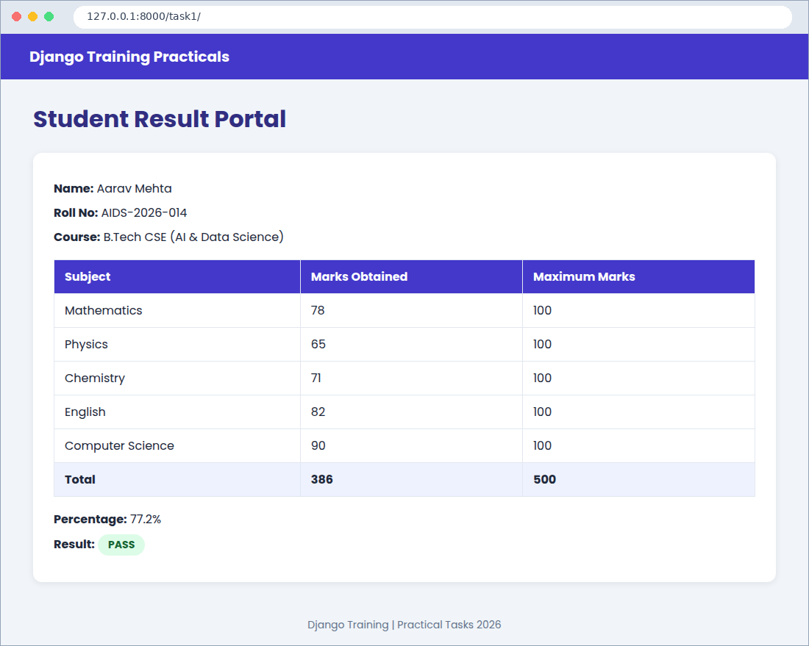
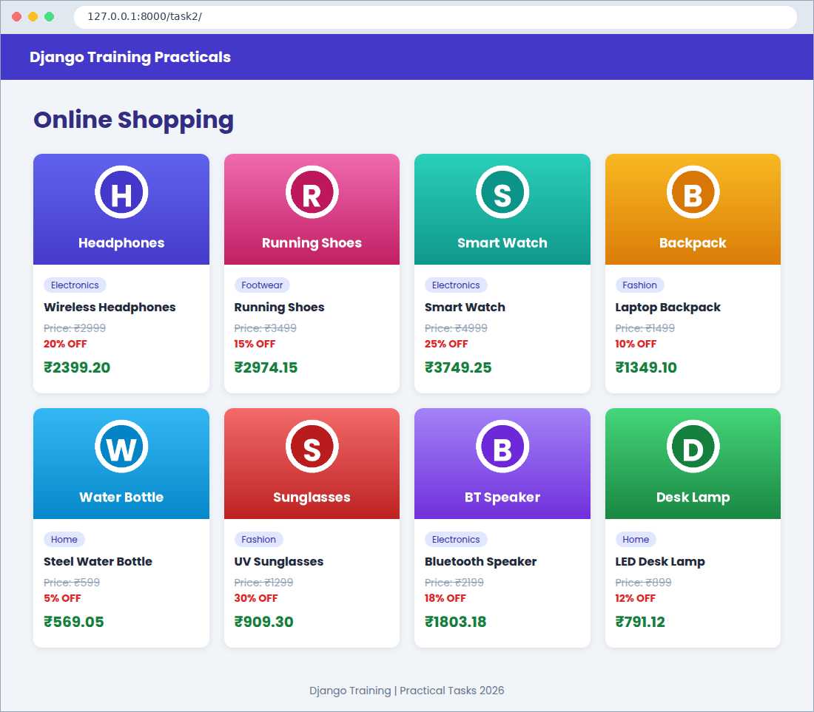
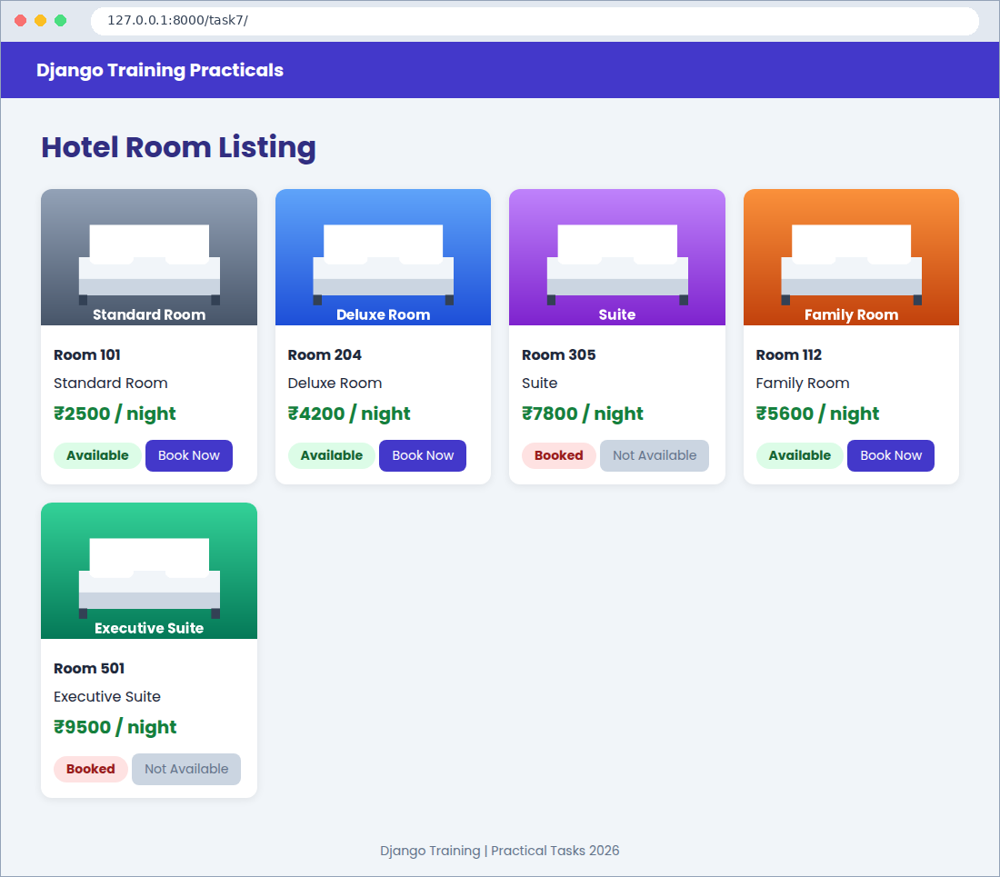
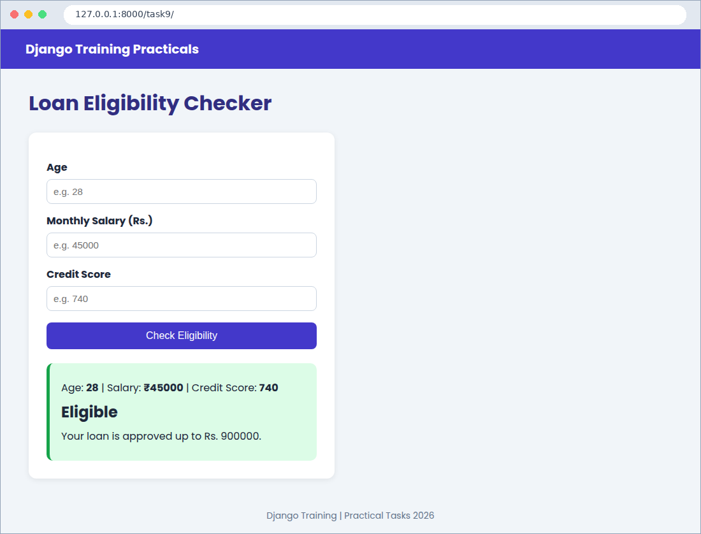
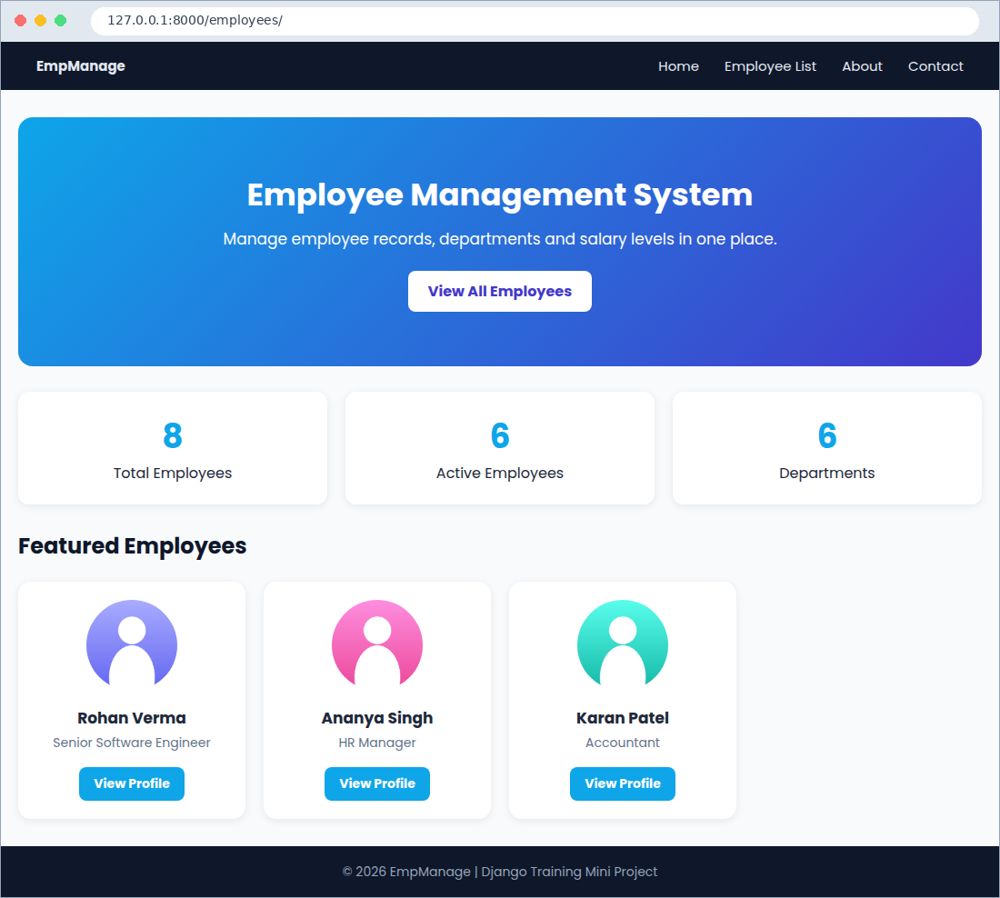
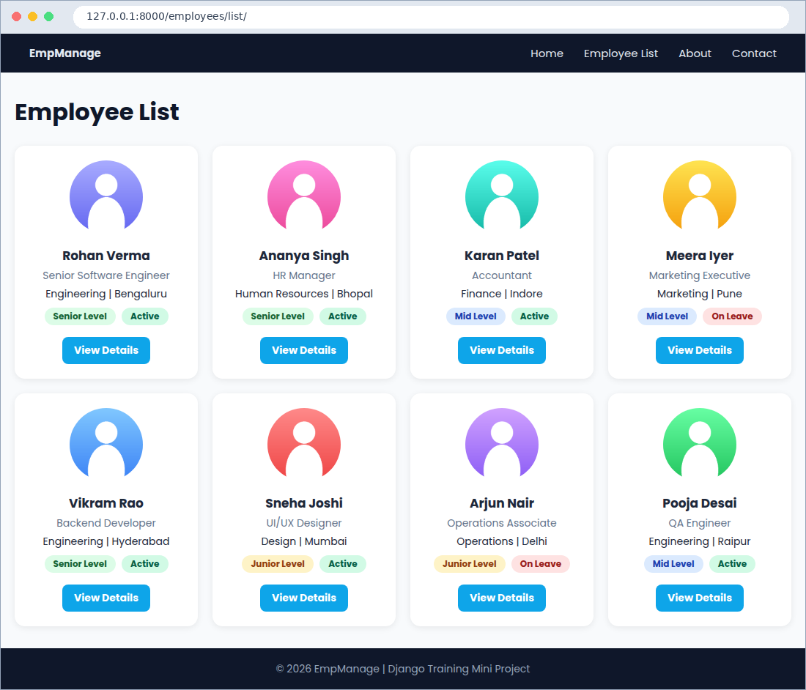
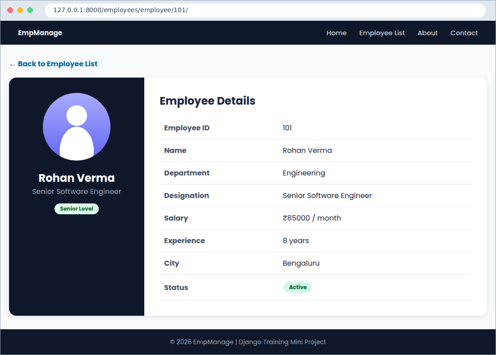

# Django Training Project

This is my Django training project, made at SISTec, Bhopal. It has 4 small tasks and
one mini project (Employee Management Website). No database is used. All the data is
stored in Python lists and dictionaries inside `views.py`.

## Tasks in this project

| Task | Name | What I practised |
|------|------|------------------|
| 1 | Student Result Portal | dictionary, `sum()`, if condition in template |
| 2 | Online Shopping Product Cards | list of dictionaries, for loop, static images |
| 7 | Hotel Room Listing | True / False value, if else in template |
| 9 | Loan Eligibility Checker | form, `and` / `or` conditions |
| 15 | Employee Management Mini Project | dynamic URL, base template, CSS |

## How to run

1. Install Python 3.10 or above.
2. Open the project folder in the terminal and install Django:

```bash
pip install -r requirements.txt
```

3. Start the server:

```bash
python manage.py runserver
```

4. Open `http://127.0.0.1:8000/` in the browser.

(You may see a message about "unapplied migrations". You can ignore it, because this
project does not use a database.)

## Pages

| URL | Page |
|-----|------|
| `/` | Home page with links to all tasks |
| `/task1/` | Student Result Portal |
| `/task2/` | Online Shopping |
| `/task7/` | Hotel Rooms |
| `/task9/` | Loan Eligibility Checker |
| `/employees/` | Employee Management - Home |
| `/employees/list/` | Employee List |
| `/employees/employee/101/` | Employee Details (change the ID: 101 to 108) |
| `/employees/about/` | About |
| `/employees/contact/` | Contact |

## Folder structure

```
django-training-project/
|-- manage.py
|-- training_project/      (settings.py, urls.py)
|-- tasks/                 (Tasks 1, 2, 7, 9)
|-- employees/             (Task 15)
|-- templates/             (HTML files)
|-- static/                (css and images)
`-- screenshots/           (output screenshots)
```

## Screenshots

**Student Result Portal**



**Online Shopping**



**Hotel Room Listing**



**Loan Eligibility Checker**



**Employee Management - Home**



**Employee Management - Employee List**



**Employee Management - Employee Details**



## Note

The images in `static/images/` are simple placeholder pictures, and the names, marks and
salaries are sample data. You can replace them with your own.

## Made by

Payal Goel - B.Tech CSE (AI & Data Science), SISTec, Bhopal
